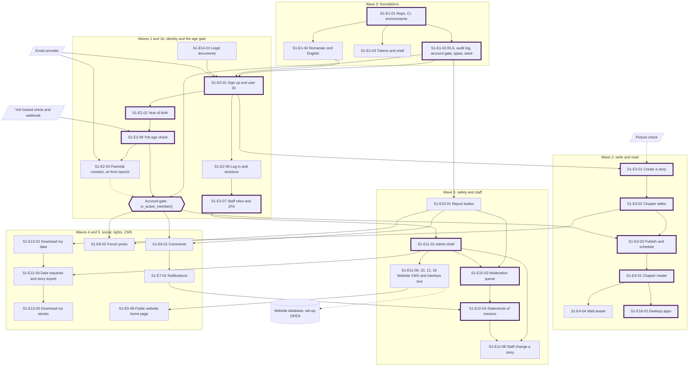

# Architecture

> Source: CTO pack, fact-checked 17 Oct 2026. The master plan's Decisions made tab wins if they differ.

## 1. Engineering principles and Stage 1 architecture

### 1.1 Engineering principles

1. **Stage 1 only.** Nothing from Stages 2 to 7 is built until the March test passes, except data shapes that would be expensive to change later (for example keeping the writing identity separate from any future verified identity).
2. **Boring, managed technology.** Postgres, React and TypeScript, with managed hosting. No servers to patch, no custom infrastructure, nothing a junior developer can't pick up in a week.
3. **The database is the security boundary.** Every rule about who can see or change data lives in Postgres row-level security, tested in CI. The app's interface is never trusted to hide things.
4. **Privacy and safety are product features.** Minors are users from day one. Minimum data, private by default, report and block everywhere and a moderation path for every piece of user content.
5. **One codebase.** One React and TypeScript web app, wrapped for desktop and phones. Platform-specific code stays in small, named adapters.
6. **Small, testable stories.** One story per Claude Code session, one pull request per story, acceptance criteria turned into tests.
7. **Write decisions down.** Architecture decision records (ADRs) in `docs/adr/`, one page each. Future hires and Claude Code both read them.
8. **Accessible by default.** WCAG 2.2 AA from the first screen, real text (never text drawn as images or on a canvas), keyboard and screen reader support.
9. **Romanian is a first-class language.** Romanian and English ship together; no hard-coded strings; correct ș and ț.
10. **Never hold users' money.** Licensed providers handle every payment and payout. Credits buy features only.
11. **Honest claims.** Copy protection "makes copying harder" (Q9), never "can't be copied" or "screenshots are blocked". No dark patterns.
12. **Reversible by default.** Open decisions sit behind feature flags or admin settings so they can land late without a release.

### 1.2 What is already decided (and shapes the architecture)

| Decision in the plan | What it means technically |
| --- | --- |
| Web, iOS, Android and desktop in Stage 1, plus an admin site | One web codebase with wrappers; the admin site is a protected part of the same app or a second small app on the same backend |
| Prototype with Claude Code, then build in Lovable, with Supabase for logins and the database (Chat). Updated 17 Oct 2026, 11:20: Claude Code builds first. **OPEN:** Lovable's role, pending a two-screen trial, because new Lovable projects now use TanStack Start (server-rendered) instead of React and Vite, and Lovable can't import an existing repository: connecting always creates a new one (research H2, 17 Oct 2026) | React, Vite, TypeScript, Tailwind, shadcn/ui and Supabase, in our own GitHub repository; whether Lovable can share it is part of the trial |
| March 2027 is web only; the desktop and phone apps come after (decided 17 Oct 2026, 34o; replaces desktop first, 15 Oct). Desktop with Tauri 2, built by GitHub Actions, signed and auto-updated, is the plan's route (master-plan/01), not a logged decision | Tauri 2 wrapper in the same repository after March; macOS runner for Mac builds |
| Two prototype iterations before release | Iteration 1 is clickable screens; iteration 2 is a real build for a closed group |
| Contextual banners and direct sponsors, no tracking; ad-network ads only from vendors that don't personalise, for everyone (16 Oct 2026, late evening) | Our own banners chosen on the server from page context; ad-network code only through S1-E12-04, never on chapter text, never in class spaces |
| Consent is the legal basis; parental consent for under-16s from launch (16 Oct 2026, late evening) | `consents` is live from the first real user; `parental_consents` is live before the first user under 18 joins (the March test is invited adults only, decided 17 Oct 2026, 12:44); S1-E2-03 is on the minors' launch gate |
| Picture uploads on from launch, every picture checked on upload by Sightengine and Arachnid Shield; moderation is in-house and report-based (16 Oct 2026, late evening) | An `image-check` edge function on every upload; no text moderation vendor and no pre-publication hold |
| Our own Supabase project in the EU (West EU, Ireland, eu-west-1) from day one, Claude Code builds first (decided 17 Oct 2026, 11:20; replaces Q37, Lovable's database first); EU hosting (Q38); GitHub Issues (Q39) | Every schema change is a migration in `supabase/migrations/` from day one; no database move is needed, so S1-E1-06 is Won't |
| Pen name optional, identity checks only where money changes hands | No legal names in Stage 1 |
| Private downvotes, no auto-archive, private messages, user-created spaces | Data model in section 1.6 |
| Plagiarism scanning only for imprint acquisitions | No scanner in Stage 1; a structured "copied from a published work" report instead |
| The app is called Ghemotoc, "An app by The Magic Coffin" (16 Oct 2026) | Name in store listings, the bundle ID and the reserved handles list; website ghemotoc.com and handle @ghemotoc everywhere (availability to be checked). Ghemotoc is a working name until the name and domain are bought (decided 17 Oct 2026, 12:47): code reads the name, site, contact addresses and handle from one brand config (S1-E1-01); today the site is ghemotoc.themagiccoffin.com and the contact address hello@themagiccoffin.com (decided 17 Oct 2026, 12:50) |
| The public website has its own database; Home and Discover are separate screens for now and Discover is the main one; they merge later (16 Oct 2026). The website CMS is built new, from scratch, on that database and linked neatly to the front end (16 Oct 2026, late evening, Q54). The CMS is built before March and is in the March MVP; website pages get their text only from the CMS, per market and language, and until the website database exists its content lives in the app's database behind one store interface (decided 17 Oct 2026, 19:14 to 19:16) | The website's data lives apart from the app's Supabase project once the website database exists; until then the CMS tables sit in the app's database behind a `WebsiteContentStore` contract, so the move swaps only the storage (section 1.8.6). Keep Home and Discover as separate routes so merging later is a routing change |
| Every account gets an automatic, permanent user ID that everything a person makes is linked to; staff can open any story and export a user's stories as Word or PDF (16 Oct 2026, late evening) | `profiles.id` is the Supabase Auth UUID and every user-owned table has a `user_id` column (section 1.6); Stories and Data requests areas in the admin site (section 1.8) |
| Romania is the first market; English-speaking countries open later, one by one, each after its legal check (decided 17 Oct 2026, 11:48; replaces "all at the same time", 16 Oct). The interface opens in Romanian for everyone, with English available in the language menu (decided 17 Oct 2026, 11:48). Moderation by our own team in both languages | Market and language switches in admin (S1-E11-05); every market still needs its legal check before it opens |

### 1.3 Architecture options for iOS and Android

The plan says to decide the mobile approach in iteration 2. These are the realistic options.

| Option | How it works | Strengths | Weaknesses | Fit with Lovable |
| --- | --- | --- | --- | --- |
| **A. Web app plus Capacitor (mobile) plus Tauri 2 (desktop)** | The Lovable React app runs inside a native shell on iOS and Android; plugins add push, secure screens and deep links | One codebase; mature plugins (push, `FLAG_SECURE`-style privacy screens, deep links); many examples Claude Code knows well | Webview apps must add real native value to pass Apple review (guideline 4.2); scrolling feel slightly below fully native | Full |
| **B. Tauri 2 for every platform** | The same Tauri wrapper used for desktop also builds iOS and Android | One wrapper and one toolchain for all four targets; the plan already notes this option | Tauri's mobile support is younger; fewer plugins (push notifications rely on community plugins); fewer examples to learn from | Full |
| **C. Expo (React Native) for mobile, plus the web app** | A separate React Native app for phones sharing the Supabase backend and business logic | Truly native screens and gestures; strong push and capture control; best long-term mobile quality | A second interface codebase; Lovable can't build it; roughly doubles interface work for a solo founder | Partial (backend only) |
| **D. Expo for everything (React Native Web)** | One React Native codebase for phones and web, with the web build wrapped by Tauri for desktop | One codebase, native on phones | Works against the Lovable decision; web output is weaker for reading layout and SEO; harder for a vibe coder | None |

**Recommendation:** Option A. It keeps the Lovable decision intact (Lovable's role is now OPEN pending a two-screen trial, section 1.2), reuses everything for desktop through Tauri (already decided) and is the best-documented path for a non-specialist working with Claude Code. Revisit Option C after the March test if mobile readers dominate and the apps feel second-rate. The decision itself stays **OPEN** until iteration 2, as the plan says.

### 1.4 The March 2027 constraint (read this before committing to scope)

- **Today to March is about 19 weeks.** Business Model Innovation and Startup Essentials take four evenings a week in November and December; Execution runs January to March. The developer and community manager are planned from launch, not before.
- **Decided 16 Oct 2026 (late evening, Q32): Robert builds without a programmer.** The March slice is re-cut to a real MVP in section 1.13: 63 stories and about 540 hours. The March test is invited adults only (decided 17 Oct 2026, 12:44), so the age check, parental consent and the data rights stories (about 132 hours) move to the minors' launch gate after March. It was 59 and about 501 before the website CMS and interface text editing joined (17 Oct 2026, 19:14 to 19:19), 66 and about 630 with the 12 epic checks (17 Oct 2026, 12:36), 54 and about 594 at 11:53, and 50 and about 564 on 16 Oct 2026, down from 53 stories and about 660. At 10 to 12 hours a week that is two and a half to three times the time to 1 March, so the test date is likely to move: March is a target, not a deadline (decided 17 Oct 2026, 19:22; section 1.13).
- **Store steps add calendar time you can't speed up:** Apple and Google developer accounts in the company's name need the company (Romanian SRL or Swedish AB: **OPEN**, Q55) and a D-U-N-S number. A new Google Play personal account currently needs a closed test with 12 testers for 14 days (check the rule when you open it), and first app reviews can take days and bounce.
- **What this means:** "all operating systems with real users by March" and "solo founder in the evenings" can't both hold. The developer hire and an SSES co-founder are off the table (Q32, Q57). Section 1.13 sets the scope. March 2027 is a target, not a deadline: the MVP scope stays as planned and the test date moves if the work needs it (decided 17 Oct 2026, 19:22).

### 1.5 Proposed Stage 1 architecture (Option A)

```
                 Readers and writers                         Staff
   ┌───────────────┬──────────────┬───────────────┐     ┌──────────────┐
   │ Web app (PWA) │ Desktop app  │ iOS / Android │     │ Admin site   │
   │ React + Vite  │ Tauri 2      │ Capacitor     │     │ same code,   │
   │ TypeScript    │ (same build) │ (same build)  │     │ staff routes │
   └───────┬───────┴──────┬───────┴───────┬───────┘     └──────┬───────┘
           │              │               │                    │
           └──────────────┴───────┬───────┴────────────────────┘
                                  │ HTTPS (Supabase JS client, user JWT)
            ┌─────────────────────▼──────────────────────────────┐
            │ Supabase project, EU region                         │
            │  Auth (email, magic link; company SSO for staff)    │
            │  Postgres + row-level security (all business rules) │
            │  Storage (pictures checked on upload)               │
            │  Edge Functions (moderation calls, email, exports,  │
            │   teaser pages with Open Graph tags)                │
            │  pg_cron jobs (ranking, retention, age rules)       │
            │  Realtime (notifications, messages)                 │
            └───────┬───────────────┬───────────────┬────────────┘
                    │               │               │
          Email provider    Picture check     Error tracking and
          (EU region)       (Sightengine,     cookieless analytics
                            Arachnid Shield)
```

**Building blocks**

| Layer | Choice | Notes |
| --- | --- | --- |
| Language | TypeScript, strict mode | Same language in the app and edge functions |
| Web app | React, Vite, Tailwind, shadcn/ui, React Router, TanStack Query | Matched Lovable's older output. New Lovable projects use TanStack Start and Lovable can't import an existing repository (research H2, 17 Oct 2026), so whether Lovable and Claude Code can share this repository is **OPEN** pending a two-screen trial |
| Forms and validation | react-hook-form and zod | The same zod schemas validate in the browser and in edge functions |
| i18n | i18next with `ro` and `en` JSON files | CI fails on missing keys |
| Backend | Our own Supabase project in the EU (West EU, Ireland, eu-west-1) from day one, opened in Robert's name and moved to the company (section 1.11) | Decided 17 Oct 2026, 11:20 (replaces Q37, Lovable's database first). Claude Code builds first; every schema change goes through a migration from day one. S1-E1-06 is no longer needed |
| Database rules | Postgres row-level security plus a few `security definer` functions for actions that span tables | Tested with pgTAP |
| Search | Postgres full-text search with the `romanian` and `english` configurations and `unaccent` | Enough for Stage 1; no search service needed |
| Scheduled jobs | `pg_cron` | Ranking, age rule changes on 1 January, retention purges, scheduled chapters |
| Age check | Yoti Age Verification Service: hosted page opened in the system browser, result by signed webhook to an edge function | Decided 16 Oct 2026; price, buffer and contract **OPEN** (S1-E2-08) |
| Teaser and link previews | An edge function that renders a small HTML page with Open Graph tags for `/s/:story/:chapter` | A single-page app alone can't give WhatsApp or TikTok a preview |
| Desktop | Tauri 2 with content protection, the updater and signed builds | After March: March 2027 is web only (decided 17 Oct 2026, 34o). Tauri 2 is the plan's route (master-plan/01), not a logged decision |
| Mobile | Capacitor with push, privacy screen and deep link plugins | **OPEN** until iteration 2 |
| Email | A transactional provider with an EU region | Choice **OPEN** (Q49). Recommendation: Brevo (French, EU); needs a data processing agreement |
| Moderation | In-house moderators, acting on reports; no text moderation vendor and no hold before publishing | Decided 16 Oct 2026, late evening (Q42, Q43) |
| Picture check | Every uploaded picture goes to Sightengine (nudity, gore) and Arachnid Shield (hash matching against known child abuse images) on upload; a flagged picture is held for an in-house moderator | Decided 16 Oct 2026, late evening (S1-E10-05); both need data processing agreements |
| Word and PDF files | Word (.docx) from the first version, PDF later | Recommendation (Q49): the `docx` npm library for Word, `pdf-lib` for certificates; PDF for stories **OPEN** |
| Helpdesk | Tickets inside our admin site, linked to hello@themagiccoffin.com, with a ready-made external helpdesk behind it through its API (S1-E11-13) | Decided 17 Oct 2026; product **OPEN** |
| Analytics | Cookieless, EU-hosted | Choice **OPEN** (Q49). Recommendation: Plausible or Umami Cloud (EU) |
| Error tracking | Sentry (EU data region) or similar, with personal data scrubbing | Never send emails, IPs or user text |

### 1.6 Core data model (Stage 1)

Names are suggestions for Claude Code. Every table has row-level security.

| Area | Tables |
| --- | --- |
| Identity | `profiles` (`id` is the user ID; handle, handle_slug, pen name, bio, avatar, locale, country_code, birth_year, birth_month (only when the year leaves the age unclear at 13 or 16), age_check_result, age_checked_at, age_check_method, settings), `age_check_sessions` (short-lived link between a Yoti session and a user, deleted once the result is stored), `parental_consents`, `user_sessions` (signed-in devices, no IP address), `staff_roles`, `staff_permissions`, `on_call_rota`, `blocks`, `follows_users`, `username_word_lists`, `username_approvals` |
| Writing | `stories`, `story_revisions` (settings and metadata history, including staff changes), `chapters` (status, scheduled time, structured content), `chapter_revisions`, `story_tags`, `tags`, `categories`, `content_labels`, `ratings` (All ages, 13+, 16+, 18+) |
| Reading | `reading_progress`, `library_entries`, `reading_lists`, `reading_list_stories` (GAPS-6), `likes`, `chapter_reads` (daily totals per chapter; no per-reader records) |
| Discussion | `comments`, `reactions`, `downvotes` (private), `forums`, `spaces`, `space_members`, `space_roles`, `threads`, `posts`, `post_revisions`, `read_marks` (user, forum and thread levels) |
| Messages | `conversations`, `conversation_members`, `messages`, `message_requests` |
| Safety | `reports`, `cases`, `case_actions`, `picture_checks`, `statements_of_reasons`, `appeals`, `sanctions`, `authority_orders`, `audit_log` |
| Money (Stage 1 only sponsors) | `sponsors`, `campaigns`, `campaign_daily_stats` |
| Schools | `schools`, `teacher_checks`, `invites` (shared with platform invites, S1-E11-17), `certificates` |
| Data rights | `exports`, `data_requests` |
| Platform | `feature_flags`, `settings`, `rate_limits`, `reserved_names`, `markets`, `languages`, `seasonal_occasions`, `legal_documents`, `consents`, `notifications`, `jobs` |
| Website content (CMS). For March: in the app's database behind one store interface (decided 17 Oct 2026, 19:16); moved to the website's own database once it exists (set-up OPEN) | `cms_pages` and `cms_page_versions` (one page per page type, market and language, the home page first; draft, scheduled and published versions with a "show from" date), `notice_banners`, `help_pages`, `faq_items` (each per market and language): read by website pages only through published views, written only through `admin_*` functions behind the `WebsiteContentStore` contract (section 1.8.6). `interface_text_overrides` (locale key, BCP 47 locale code, text, version, "show from"; laid on top of the ro and en locale files, S1-E11-18) stays in the app's database, because the app reads it |

**Rules baked into the model**

- `profiles` never stores a legal name, a full date of birth, a selfie, an ID image or an estimated age. Age is year of birth (plus the month only when the year leaves the age unclear at 13 or 16) plus the Yoti result, its date and its method.
- Every user-content table registers with the reporting system (a `reportable_type` enum), so a new content type can't ship without a report button.
- Downvotes are readable only by staff.
- Messages are readable by the two members and, only for messages attached to a report, by moderators.
- Soft delete (`deleted_at`) on user content with purge jobs; hard delete after the retention period.
- Staff changes go through `admin_*` functions that write `audit_log` in the same transaction. `audit_log` is append-only: no role, the owner included, can update or delete a row.

**The user ID (decided 16 Oct 2026, late evening)**

- **Created automatically at sign-up.** Supabase Auth gives every new account a random UUID and the same value becomes `profiles.id`. Email, Google, Apple and Microsoft sign-ups all get one the same way.
- **Never changes and is never reused**, even after the account is deleted. A trigger refuses any change to `profiles.id` and to the owner column of any row. One exception: a space's owner (`spaces.user_id`) changes when one of its moderators accepts the owner's offer to hand it over (decided 4 Nov 2026, 12:53; IDEA-20261102-7).
- **Everything points to it.** Every story, chapter, comment, reaction, post, message, report, appeal, certificate, export and data request has a `user_id` column (not null, references `profiles.id`). Other people in a row get role names such as `reporter_user_id` or `target_user_id`. CI fails a new user-content table without it (S1-E1-02).
- **The handle and pen name can change; the ID can't.** Earlier handles stay in the audit log so staff can still find old work.
- **Never shown publicly:** not on any screen, in a URL, a link preview, a share card or a public view. Public views carry the handle and pen name instead, and actions on another person (follow, block, message) go through functions that take a handle or a story ID. Staff see the ID in the admin site (shortened, with a copy button) and the user sees it in their own exports.
- It is pseudonymous personal data, not a secret: it needs no encryption, but it isn't published.

### 1.7 Front end and back end dependencies

Added 16 Oct 2026 (late evening) at Robert's request. This is the build map: what each screen needs from the back end, what has to be real before a screen can be built and what can be faked until then.

In this stack the back end is mostly the database: tables, row-level security (RLS) and a few SQL functions, plus a small number of edge functions for anything that needs a secret or talks to another company. So the "API" a screen depends on is usually a migration. Get the migration right first and most screens can be built against a local Supabase with seed data. Only a handful of pieces need real fakes: Yoti, email, the moderation and image checks, PDF and Word files and the website's own database.

#### 1.7.1 Three rules

1. **Contract first.** No screen is built until the tables, RLS policies and function signatures it uses are merged and the TypeScript types are generated from them. The body of a function can come later; its name, inputs and outputs can't.
2. **Mock the outside, never the database.** Postgres is never mocked: the local Supabase stack (Docker) is real, free and fast, so screens are built against it with seed data. Third parties and our own edge functions are mocked while they don't exist yet.
3. **Real before Done.** A story can be built against a mock, but it is only Done when everything it uses is real on staging, or the part that isn't real sits behind a feature flag that is off.

#### 1.7.2 Contract first, step by step

For any story that touches both the database and a screen, Claude Code works in this order, in one branch and one pull request:

| Step | What | Where | Command or check |
| --- | --- | --- | --- |
| 1 | Migration: tables, enums, RLS policies and function signatures (a function whose logic comes later raises `not implemented`) | `supabase/migrations/` | `npm run migration:new -- <story_id>_<slug>` (QA-4) |
| 2 | pgTAP tests: an allowed and a denied test per policy | `supabase/tests/` | `npx supabase test db` |
| 3 | Generate the types from the local database | `src/lib/database.types.ts` | `npm run types:gen` (runs `supabase gen types typescript --local`) |
| 4 | Shared contracts: zod schemas for every edge function's request and response, plus helpers such as `Tables<'stories'>` and `Enums<'age_check_result'>` | `src/shared/contracts/`, imported by edge functions through their import map | `npm run typecheck` |
| 5 | Fixtures and seed: typed fixtures (`satisfies Tables<'stories'>`) and seed personas | `src/test/fixtures/`, `supabase/seed.sql` | a schema change that breaks a fixture fails the type check, which is the point |
| 6 | Mocks for edge functions and third parties: MSW handlers typed from the contracts | `src/test/msw/` | used by Vitest; in local development, switched on per function with `VITE_MOCK_FUNCTIONS=yoti,email` |
| 7 | Screens, built against the generated types and the seed | `src/features/<feature>/` | Lovable or Claude Code |
| 8 | The real edge function or job, then the mock comes off the local list (it stays for unit tests) | `supabase/functions/` | `npx supabase functions serve` |

**What is never written by hand:** table row types, enums (`reportable_type`, `age_check_result`, `story_status`, `staff_role` and so on) and function argument types. If a TypeScript type mirrors something in the database, it is generated. CI runs `npm run types:check`, which regenerates the types and fails if they differ from the committed file.

**Seed personas.** `supabase/seed.sql` creates the same test accounts in every local and staging database. Years of birth are worked out from the current year so the personas never age out of their group.

| Persona | Age group | State | Used to test |
| --- | --- | --- | --- |
| `adult_writer` | 18 or over | active, "18 or over" result | the normal path |
| `teen_17` | 16 to 17 | active, "13 or over" result | under-18 protections without parental consent |
| `kid_14_ok` | 13 to 15 | active, parent agreed | the full minor path |
| `kid_14_waiting` | 13 to 15 | waiting for a parent | read-only until consent |
| `pending_check` | any | age check not done | read-only, 14-day clean-up |
| `failed_check` | any | failed, manual check requested | read-only, manual check queue |
| `teacher` | 18 or over | Teacher badge approved | class spaces |
| `owner`, `admin`, `moderator`, `support`, `editor` | 18 or over | staff, Google Workspace session | staff areas and least privilege |
| `suspended_user`, `banned_user` | 18 or over | sanctioned | sanctions everywhere |
| `blocker`, `blocked` | mixed | one blocks the other | blocks everywhere |

#### 1.7.3 The back-end pieces

Each piece has an ID (B01 and so on) so the screen tables below can point to it.

| ID | Piece | Built in | While it isn't built yet |
| --- | --- | --- | --- |
| B01 | Supabase project, migrations, CI, generated types | S1-E1-01, S1-E1-02 | nothing to mock; it comes first |
| B02 | **Account gate:** SQL functions `account_state(user_id)`, `is_active_member()`, `age_band()`, `is_staff(role)` and `is_staff_session()` used by every write policy | skeleton in S1-E1-02, filled in by S1-E2-01, S1-E2-02, S1-E2-08, S1-E2-03 and S1-E10-06 | seed personas set the state directly |
| B03 | Audit log: append-only `audit_log` table and `log_staff_action()` | S1-E1-02 | nothing to mock |
| B04 | Reporting registry: `reportable_type` enum, `reports`, `report_item()` | enum in S1-E1-02, the rest in S1-E10-01 | the Report button can call a stub until S1-E10-01 |
| B05 | Auth and `profiles`: the user ID is created here (section 1.6) | S1-E2-01 | local Supabase Auth is real; local email goes to Mailpit |
| B06 | Legal documents and consents | S1-E14-01 | one seeded version of each document |
| B07 | Age check: `age-check-start` and `yoti-webhook` edge functions, `age_check_sessions`, manual check requests | S1-E2-08 | a local `yoti-mock` function and a script that sends a webhook signed with a test key (pass, fail, time-out); the Yoti sandbox on staging before Done |
| B08 | Parental consent: `parental_consents`, `consent-request` and `consent-confirm` | S1-E2-03 | Mailpit catches the parent's email |
| B09 | Email: Brevo (decided 17 Oct 2026, 19:43) and one `send-email` edge function that every email goes through, Auth emails included through Supabase's Send Email hook; templates in both languages from `email.json` with admin overrides (B34), locked placeholders and codes made by Supabase Auth (decided 25 Oct 2026, 09:18 to 09:21) | Auth email in S1-E2-01; the shared sender and admin editing in S1-E11-19; notifications in S1-E7-02 | Mailpit locally; Brevo only on staging and production |
| B10 | Staff roles, permissions and `is_staff_session()` (Google Workspace sign-in with Google's 2-Step Verification) | S1-E2-07 | locally, a test flag marks a seeded staff persona's session as a Google Workspace session |
| B11 | Markets, languages and the country from the connection (`signup-context`) | S1-E11-05, S1-E2-10 | seeded rows; the country header faked by a local-only setting |
| B12 | Settings, feature flags, rate limits and reserved names, read by `get_client_config()` | tables in S1-E1-02, admin screens in S1-E11-03 | seeded defaults |
| B13 | Writing: `stories`, `chapters`, revisions, tags, categories, content labels, `save_chapter_draft()` | S1-E3-01 to S1-E3-08 | nothing to mock |
| B14 | Storage buckets: `covers`, `avatars`, `chapter-images`, `teacher-proofs`, `exports`, `evidence`, `sponsor-creatives` | the first story that uploads to each | local Storage is real |
| B15 | Picture check: `image-check` function calling Sightengine and Arachnid Shield on upload, `picture_checks`, the held state and a moderation case for flagged pictures | S1-E10-05 | `IMAGE_CHECK=stub` passes every file except names ending `_fail`; the vendors' test keys on staging before Done. Picture uploads are on from launch (16 Oct 2026, late evening) |
| B16 | Events: `chapter_published` and `content_saved` and the `jobs` queue, used by notifications. No automated text pre-screening (decided 16 Oct 2026, late evening, Q42 and Q43) | S1-E3-03 | nothing to mock |
| B17 | Scheduled jobs (`pg_cron`): scheduled chapters, ranking, retention, age rules, the 14-day clean-up, daily metrics | S1-E3-03, S1-E5-03, S1-E13-04, S1-E2-08, S1-E15-02 | tests call the job's SQL function directly |
| B18 | Search: Postgres full-text `search_stories()` and `search_posts()` | S1-E5-04, S1-E8-10 | nothing to mock; Stage 1 has no outside search service |
| B19 | Teaser and link previews: the `teaser` function (server-rendered HTML with Open Graph tags) | S1-E4-04 | runs locally |
| B20 | Reading: `reading_progress`, `library_entries`, `likes`, `chapter_reads` | S1-E4-03, S1-E6-03 | nothing to mock |
| B21 | Discussion and people: `comments`, `reactions`, `downvotes`, `follows`, `blocks` | S1-E6, `blocks` in S1-E5-05 | nothing to mock |
| B22 | Notifications: `notifications`, triggers, Realtime; email digests; push tokens | S1-E7-01 to S1-E7-03 | Realtime runs locally; push is a stub until S1-E16-03 |
| B23 | Forums and spaces: forums, threads, posts, revisions, read marks, spaces, members, roles | S1-E8 | nothing to mock |
| B24 | Schools: `schools`, `teacher_checks`, class space fields, `invites` (purpose `class_space`), `certificates`, `certificate-pdf` | S1-E2-11, S1-E8-11, S1-E8-12 | the PDF is a stub until S1-E8-12 |
| B25 | Messages: conversations, messages, requests, `can_message(a, b)` | S1-E9 | nothing to mock |
| B26 | Safety: `cases`, `case_actions`, `statements_of_reasons`, `appeals`, `sanctions`, `authority_orders`, queue views, on-call alert | S1-E10 | the phone alert is a stub that only logs |
| B27 | Admin functions: `admin_*` functions, each checking role, permission and `is_staff_session()` and writing the audit log in the same transaction | S1-E11 | nothing to mock |
| B28 | Data rights: `exports`, `export-build`, `data_requests`, `story-export` (Word from the first version, PDF later; the shared Word builder is built in S1-E13-02, which comes first in the build order, decided 17 Oct 2026, 12:34), the deletion job | S1-E13-02, S1-E11-09, S1-E13-03, S1-E13-05 | nothing for Word (real from S1-E13-02); PDF returns a placeholder file until S1-E11-09b |
| B29 | Banners and sponsors: sponsors, campaigns, daily stats, `pick_banner(context)` | S1-E12 | one seeded test campaign |
| B30 | Seasonal looks: the season shows through the seasonal themes and their dates (`seasonal_look_dates`, `profiles.seasonal_looks`). The seasonal doodle schedule (`seasonal_occasions`, S1-E11-11) was retired in bundle NO-DOODLES (Robert, 9 Nov 2026: no doodles anywhere) | G2 (S1-E11-11 retired) | nothing to mock |
| B31 | **Website content store (CMS):** pages and page versions by market and language (the home page first), notice banners, help pages and questions, behind one `WebsiteContentStore` contract, plus `public-shelves`, a read-only list of public stories for the website. For March the store lives in the app's database and is written through `admin_*` functions (decided 17 Oct 2026, 19:16); once the website database exists (set-up OPEN), a `website-cms` bridge writes there instead and only the storage changes | S1-E11-06, S1-E11-10, S1-E11-12, S1-E5-08 | nothing to mock for March: the store is real in the app's database. The website database adapter comes later (a new CMS built from scratch, decided 16 Oct 2026, Q54) |
| B32 | Cookieless analytics and error tracking | S1-E15-01, S1-E1-05 | switched off locally |
| B33 | Desktop shell: Tauri deep link, opener, single instance, updater, content protection | S1-E16-02 | build on the web first; the desktop parts are tested when S1-E16-02 lands |
| B34 | **Interface text overrides:** `interface_text_overrides` in the app's database, `admin_*` functions to save, publish, restore and reset, and a read of the published overrides for one locale that the app lays over the ro and en locale files (decided 17 Oct 2026, 19:16). Email templates use the same overrides, read by the `send-email` function (decided 25 Oct 2026, 09:19) | S1-E11-18, S1-E11-19 | nothing to mock; if the read fails the app uses the file text |

#### 1.7.4 What each screen group needs

Screen numbers are the design canvas numbers. "Real before building" is the smallest thing that has to be merged before the screen can be built at all; everything else can be mocked as shown.

**A. Public website (1.1)**

For March the public home page (S1-E5-08) is a page of the web app (decided 17 Oct 2026, 12:34), but its text comes only from the CMS (S1-E11-06 for the hero and safety lines, S1-E11-12 for the questions), never from the locale files (decided 17 Oct 2026, 19:14; replaces the 12:34 locale-file rule). The CMS content sits in the app's database behind the `WebsiteContentStore` contract until the website database exists (decided 17 Oct 2026, 19:16). The page picks the visitor's market (the country from the connection, S1-E2-10) and language; a visitor from a country with no page of its own sees the Romanian market's English page (decided 17 Oct 2026, 19:16). The rows come from the app's own public views or `public-shelves`. The top bar, footer and language menu are interface text: they stay in the locale files, with admin overrides from S1-E11-18.

| Screen part | Stories | Back-end pieces | Real before building | Mock while building |
| --- | --- | --- | --- | --- |
| Hero, safety lines and the three points | S1-E5-08, S1-E11-06 | B31 published home page version for the market and language | the published-page contract (fields, market, language, fallback) | nothing: version 1 (the copy live on 16 Oct 2026) is seeded for the Romanian market in ro and en |
| Trending, Completed, New and rising rows | S1-E5-08, S1-E5-03 | B31 `public-shelves` reading the app's public views; B13; B17 ranking | the `public-shelves` response contract | a fixture of 12 stories including one app-only story; real once S1-E5-03 runs |
| Questions | S1-E5-08, S1-E11-12 | B31 questions (per market and language) | the contract | nothing: the 16 Oct 2026 questions are seeded as version 1 |
| Notice strip | S1-E11-10 | one notice table read by the website and the app, per market and language; in the app's database until the website database exists (decided 17 Oct 2026, 12:44) | the contract | nothing: real in the app's database |
| Download buttons | S1-E16-02 | the release list the Tauri updater already publishes | nothing | fixed links |

The website never reads the app's tables directly. It reads only its own database, `public-shelves` and the release list, so a fault on the website can't expose app data. From March: inside the app until the website database exists (decided 17 Oct 2026, 12:34); this rule applies once the website is split out. Until then the page reads only the published CMS views, `public-shelves` and the public story views, never the CMS editing tables.

**B. Join and log in (2.1 to 2.5)**

| Screen | Stories | Back-end pieces | Real before building | Mock while building |
| --- | --- | --- | --- | --- |
| 2.1 Sign up | S1-E2-01, S1-E2-02, S1-E2-09, S1-E10-12, S1-E14-01 | B05, B02, B06, B09, B12 (reserved names, rate limits) | B05 with the user ID trigger, B02 skeleton, one seeded legal version | Mailpit; Google, Apple and Microsoft need real developer apps, so test them on staging and hide the buttons locally with the `social_login` flag |
| 2.2 Log in and reset password | S1-E2-05, S1-E2-09 | B05, `user_sessions` (our own list of signed-in devices, because Supabase Auth doesn't give users one) | B05 | Mailpit |
| 2.3 Age check | S1-E2-08 | B07, B02, B33 (desktop return) | `age_check_sessions`, the profile age columns and the start function's contract | `yoti-mock` plus the signed test webhook; Yoti sandbox before Done |
| 2.4 Parent's consent | S1-E2-03 | B08, B12 (`parental_consent` flag), B09 | the table and the flag | Mailpit; persona `kid_14_waiting` |
| 2.5 Onboarding | S1-E2-04, S1-E2-06, S1-E2-10, S1-E2-11 | B05 (handle, pen name, language), B12 (reserved names), categories and tags (B13, seeded), B11, B24 (teacher checks), B14 `teacher-proofs` | profile columns, seeded categories and tags | country header faked locally; the teacher step stubbed until S1-E2-11 |

**C. Discover and read (3.1 to 3.9)**

| Screen | Stories | Back-end pieces | Real before building | Mock while building |
| --- | --- | --- | --- | --- |
| 3.1 Discover | S1-E5-01, S1-E5-02, S1-E5-03, S1-E5-07, S1-E5-09, S1-E12-01 | public story views (handle and pen name, never the user ID), B17 ranking scores, B21 blocks, B02 `age_band()`, B30, B29 | the public views and the rating filter in RLS | seed 40 stories, including one of each rating, one app-only and one by a blocked writer; the Discover mix needs S1-E5-03 |
| 3.2 Search | S1-E5-04 | B18 | the function signature and index | real locally |
| 3.3 Classics shelf | S1-E5-06 | the official account and the public-domain label | nothing extra | seed |
| 3.4 Story page | S1-E3-05, S1-E3-06, S1-E3-08, S1-E6-05 | B13, B21 follows, the `read_on` setting | the public views | seed |
| 3.5 Chapter reader | S1-E4-01, S1-E4-02, S1-E4-06, S1-E6-01 to 03, S1-E6-06, S1-E12-01 | `get_chapter()` (checks status, `read_on`, the reader's age against the story's rating and blocks in one place), B20, B21, B29, reader settings in `profiles.settings` | `get_chapter()` and its RLS tests | seed; a banner fixture |
| 3.6 Share and quote card | S1-E4-05, S1-E4-07, S1-E4-11 | a share counter; the quote card is drawn on the device | the counter | nothing |
| 3.7 Library | S1-E4-03 | B20 | the tables | seed |
| 3.8 Shared link (teaser) | S1-E4-04 | B19, B12 (`teaser_length`) | the function contract | runs locally |
| 3.9 App-only story on the web | S1-E4-09, S1-E3-08 | `read_on`, B33 for "Open in the app" | the column | deep link mocked until S1-E16-02 |

**D. Write (4.1 to 4.4)**

| Screen | Stories | Back-end pieces | Real before building | Mock while building |
| --- | --- | --- | --- | --- |
| 4.1 Writer dashboard | S1-E3-07 | `writer_stats` view over daily `chapter_reads` totals (the "fewer than 5" rule is in SQL) | the view | seeded totals |
| 4.2 New story and settings | S1-E3-01, S1-E3-05, S1-E3-06, S1-E3-08, S1-E3-12, S1-E3-13 | B13, open languages (B11), B14 `covers`, B15 for uploads; drawn and automatic covers need no back end (SVG files and a function of the story ID) | `stories` with RLS by user ID | image check stub; languages seeded |
| 4.3 Chapter editor | S1-E3-02, S1-E3-09, S1-E3-10, S1-E3-11 | `chapters`, `save_chapter_draft()` with a version number to spot conflicts, revisions, B14 `chapter-images`, an `oembed` function with the allow-list | `chapters` and the save function | oEmbed fixtures; image check stub |
| 4.4 Manage chapters | S1-E3-03, S1-E3-04 | publish, schedule and reorder functions, B17 publisher, B16 event | the functions | tests call the publisher job directly |

**E. Forums, spaces and messages (5.1 to 5.5)**

| Screen | Stories | Back-end pieces | Real before building | Mock while building |
| --- | --- | --- | --- | --- |
| 5.1 Forums | S1-E8-01, S1-E8-04, S1-E8-10 | B23, B18 | the tables | seed |
| 5.2 Forum thread | S1-E8-02, S1-E8-03, S1-E8-05, S1-E8-08, S1-E8-09, S1-E6-04 | B23, B21 downvotes, ranks view | the tables | seed |
| 5.3 A user space | S1-E8-06, S1-E8-07 | B23 | the tables | seed |
| 5.4 Private class space | S1-E8-11, S1-E8-12, S1-E2-11 | B24, B23 | the badge and invites | persona `teacher` |
| 5.5 Messages | S1-E9-01 to 04 | B25, Realtime | `can_message()` with a pgTAP test for every age pairing | real locally |

**F. Profile, notifications, settings and reports (6.1 to 6.5)**

| Screen | Stories | Back-end pieces | Real before building | Mock while building |
| --- | --- | --- | --- | --- |
| 6.1 Writer profile | S1-E5-05, S1-E6-05, S1-E8-08 | public profile view (no user ID, no age), B14 `avatars`, B21 | the view | seed |
| 6.2 Notifications | S1-E7-01 to 03 | B22 | the table | Mailpit; push stub |
| 6.3 Settings | S1-E13-01 to 05, S1-E2-05, S1-E2-09, S1-E9-04, S1-E8-12 | `profiles.settings`, Auth identities, `user_sessions`, B28 | `exports` and the job contract | PDF placeholder until S1-E11-09b (Word is real from S1-E13-02) |
| 6.4 Report something | S1-E10-01, S1-E10-08 | B04 | `report_item()` | nothing |
| 6.5 My reports and appeals | S1-E10-04, S1-E10-07 | B26 (the reporter's own rows) | the views | a seeded closed case |

**G. Help, legal, app download and ads (7.1 to 7.5)**

| Screen | Stories | Back-end pieces | Real before building | Mock while building |
| --- | --- | --- | --- | --- |
| 7.1 Get the app | S1-E16-01, S1-E16-02 | the release list | nothing | fixed links |
| 7.2 Legal centre | S1-E14-01 to 03 | B06 | the table | seed |
| 7.3 Report without an account | S1-E10-02 | a `public-notice` function (bot check, rate limit), B26, B09 | the contract | Mailpit |
| 7.4 Error, offline and maintenance | S1-E1-05 | B12 `maintenance_mode` | `get_client_config()` | seeded flag |
| 7.5 Ad and sponsor formats | S1-E12-01, S1-E12-02 | B29 | `pick_banner()` | one seeded campaign |

**H. Staff and admin (8.1 to 8.12 and the website CMS)**

| Screen | Stories | Back-end pieces | Real before building | Mock while building |
| --- | --- | --- | --- | --- |
| 8.1 Staff log in | S1-E2-07 | B10, lock-out alert email | B10 | nothing |
| 8.2 Moderation queue | S1-E10-03, S1-E10-05 | B26 queue view with tier and deadline, B16 results | `cases` and the view | 20 seeded cases across the tiers |
| 8.3 Moderation case | S1-E10-04, S1-E10-06, S1-E10-08, S1-E10-10, S1-E10-11 | B26, B14 `evidence`, moderator mail inbox | the tables | seed |
| 8.4 Appeals and removal orders | S1-E10-07, S1-E10-09 | B26, `emergency_disable()` | the function | alert stub |
| 8.5 Users | S1-E11-02, S1-E2-08 (manual checks) | B27 `admin_user_lookup()` (handle, email or user ID; revealing an email is logged) | the function | seed |
| 8.6 Settings, flags, markets | S1-E11-03, S1-E11-05, S1-E10-12 | B11, B12 | the tables | seed |
| 8.7 Metrics and logs | S1-E11-04, S1-E15-02 | B17 daily metrics, compliance log | the metrics table | seeded totals |
| 8.8 Sponsors and banners | S1-E12-02, S1-E12-03 | B29, B14 `sponsor-creatives` | the tables | seed |
| 8.9 Schools and certificates | S1-E2-11, S1-E8-11, S1-E8-12 | B24, B14 `teacher-proofs` | the tables | seed |
| 8.10 Stories | S1-E11-07 | B27 `admin_search_stories()` (title, current or earlier handle, user ID) | the function | seed |
| 8.11 Story in admin | S1-E11-08 | B27 `admin_update_story()`, `admin_remove_passage()`, story and chapter revisions, B26 statements | the functions | seed |
| 8.12 Data requests | S1-E11-09 | B28 | `data_requests` and the job contract | PDF placeholder until S1-E11-09b (Word is real from S1-E13-02) |
| Website CMS and interface text | S1-E11-06, S1-E11-10, S1-E11-12, S1-E11-18 | B31 store in the app's database (the website database later), B34 interface text; B30 lives in the app's database | the `WebsiteContentStore` contract | nothing for March: real in the app's database |
| Audit log | S1-E11-01 | B03 | B03 | nothing |

#### 1.7.5 How to mock each kind of piece

| Piece | Unit and component tests (Vitest) | Local development | Staging |
| --- | --- | --- | --- |
| Tables and RLS | typed fixtures | local Supabase with the seed personas | real |
| SQL functions (RPCs) | fixtures through a typed wrapper around `supabase.rpc` | real | real |
| Our edge functions | MSW handlers typed from the contracts | real (`functions serve`) or MSW until the function exists | real |
| Yoti | MSW | `yoti-mock` plus the signed test webhook | Yoti sandbox |
| Email | MSW | the Supabase CLI's local mail catcher (Mailpit in recent versions, Inbucket in older ones) | real provider, test domain |
| Picture check | MSW | stub (`IMAGE_CHECK=stub`) | Sightengine and Arachnid Shield test keys |
| oEmbed (music and video) | fixtures | fixtures | real, allow-list only |
| Website content store | the app-database store, or a fake store with the same contract | real, in the app's database for March (decided 17 Oct 2026, 19:16) | real in the app's database; the website database adapter once it exists |
| Realtime | a fake channel | real | real |
| `pg_cron` jobs | call the job function directly | call it, or let cron run | cron |
| Push | stub | stub | stub until S1-E16-03 |
| Tauri plugins (deep link, opener, updater, content protection) | a `platform` adapter with a web version | web version in the browser, real in `tauri dev` | real desktop builds |
| Analytics and error tracking | off | off | on, with scrubbing |
| Canva | not in the March slice | | |

The `platform` adapter is the one piece of front-end architecture this needs: every call that differs between web and desktop (open a URL in the system browser, read the deep link, list device fonts, protect the window) goes through `src/lib/platform/`, with a web version and a Tauri version. Screens never import Tauri directly, so every screen can be built and tested in a browser.

#### 1.7.6 Build order

Waves run top to bottom. Inside a wave, back-end and screen work can be interleaved. You are one person, so "in parallel" means you can switch to it while something else waits (a Yoti answer, a lawyer, a review), not that both happen at once. Never edit in Lovable and Claude Code at the same time (section 4.6).

| Wave | Back end first (Claude Code) | Screens (Lovable or Claude Code) | Blocked by | Can run alongside |
| --- | --- | --- | --- | --- |
| 0 Foundations | S1-E1-01, S1-E1-02 (B01 to B04, B12 tables, seed personas, types check) | S1-E1-03, S1-E1-04, S1-E1-05 | nothing | tokens and i18n run alongside S1-E1-02 |
| 1 Identity | S1-E14-01 (table), S1-E2-01, S1-E2-02, S1-E2-04, S1-E2-05, S1-E2-07 | 2.1, 2.2, 2.5 (handle only), 8.1 | wave 0 | wave 2 back end, because seed personas stand in for real age checks |
| 1b Age gate (critical) | S1-E2-08 (08a web, then 08b), S1-E2-03 (on from launch) | 2.3, 2.4 | S1-E2-02; a Yoti sandbox account | waves 2 and 3 |
| 2 Write and read | S1-E3-01, S1-E3-02, S1-E3-03, S1-E3-05, S1-E3-06; S1-E4-01, S1-E4-03, S1-E4-04; S1-E5-05 | 4.2 to 4.4, 3.4, 3.5, 3.7, 3.8, 6.1 | wave 0 and S1-E2-01 | wave 1b; S1-E16-02 can start the day S1-E4-01 is merged |
| 3 Safety and staff | S1-E10-01, S1-E11-01, S1-E10-03, S1-E10-04, S1-E10-06, S1-E10-02, S1-E10-09, S1-E10-10, S1-E10-12, S1-E11-02, S1-E11-03, S1-E11-06, S1-E11-10, S1-E11-12, S1-E11-18 | 6.4, 7.3, 8.2 to 8.6, 8.14 (Website) | S1-E2-07 | wave 2 |
| 4 Social and discovery | S1-E6-01, S1-E6-03, S1-E6-05, S1-E7-01, S1-E5-01, S1-E5-02, S1-E5-04, S1-E8-01, S1-E8-02, S1-E8-05 | 3.1, 3.2, 5.1, 5.2, 6.2 | S1-E10-01 before any comment or post; wave 2 | wave 5 |
| 5 Rights, numbers and shipping | S1-E13-01 to 04, S1-E11-09, S1-E15-01 to 03, S1-E16-01, S1-E16-02 | 6.3, 8.7, 8.12, 7.1 | waves 2 to 4 | S1-E16-02 from wave 2 onwards |
| After March | everything else, in the order of section 1.13 | | | |

Updated 17 Oct 2026, 12:44: the March test is invited adults only, so wave 1b (S1-E2-08, S1-E2-03), S1-E2-07b, S1-E10-13b and the data rights stories in wave 5 (S1-E13-02 to 05, S1-E11-09a) come after March and before minors go live; S1-E2-07a stays in wave 1 and S1-E10-13a in wave 3.

Updated 17 Oct 2026, 19:14 to 19:19: the website CMS joins wave 3 after S1-E11-01: S1-E11-06 first (the shared CMS core and the home page), then S1-E11-10, S1-E11-12 and S1-E11-18 (interface text, which reuses the same editor). S1-E5-08 stays in wave 4 and now needs S1-E11-06 and S1-E11-12 first, because its text comes only from the CMS.

Every epic ends with an epic check story (S1-Ex-QA, 17 Oct 2026, 12:36): it runs once the epic's March stories are merged, in the wave of the last of them, and tests them together end to end.

Updated 16 Oct 2026 (late evening): the March MVP in section 1.13 is web only, so S1-E16-01 and S1-E16-02 leave wave 5, and S1-E4-02, S1-E4-03, S1-E5-04, S1-E8-01, S1-E8-02, S1-E8-05, S1-E10-12, S1-E11-03, S1-E13-01, S1-E15-01 and S1-E15-03 move after March. S1-E1-06 (the database move) joins wave 0 or 1 (no longer needed since 17 Oct 2026, 11:20: own Supabase from day one), S1-E2-03 joins wave 1b, S1-E2-10 wave 1, S1-E10-05 wave 3, S1-E5-03, S1-E5-09 and S1-E5-08 wave 4 and S1-E13-05 and S1-E14-04 wave 5. The waves keep their order.

#### 1.7.7 Dependency map

Thick borders mark the critical path (1.7.8). Dotted lines are "mockable until": the story can be built without the piece, but not finished.



#### 1.7.8 The critical path

There are two chains. The build chain has to close before the March test. The launch gate has a March part (invited adults) and a minors' part that has to close before anyone under 18 joins (decided 17 Oct 2026, 12:44).

**1. The build chain** (the longest run of stories that each wait for the one before):
S1-E1-01 → S1-E1-02 → S1-E2-01 → S1-E3-01 → S1-E3-02 → S1-E3-03 → S1-E4-01.
That is 2 L and 5 M stories, about 120 hours with Claude Code, now that the desktop app moves after March (section 1.13). At 10 to 12 hours a week it is 10 to 12 weeks on its own, out of about 19 left. Anything that slips on this chain moves March.

**2. The launch gate.**

- **In March (invited adults only, decided 17 Oct 2026, 12:44):** S1-E2-01 with the `invite_only` flag and S1-E2-02 with the `adults_only` flag (both proposals) keep the test to invited adults, and S1-E2-07a → S1-E11-01 → S1-E10-03 → S1-E10-04 (plus S1-E10-09 and S1-E10-10) give a working moderation path. Data requests arrive by email and are answered by hand.
- **Before minors go live** (what has to be real before the first under-18 can publish, comment, post or message): S1-E2-02 → S1-E2-08 → S1-E2-03 (parental consent, decided 16 Oct 2026) feed the account gate, S1-E2-07b moves staff to Google Workspace sign-in, and the data rights stories (S1-E13-02 to 05, S1-E11-09a) are in place.

Why the age check gates everything a minor can do: every write policy in the database (publish a chapter, comment, post in a forum, send a message, create a space, join a class) calls one function, `is_active_member()`. It returns true only when the email is confirmed, an age check has passed, a parent has agreed where the flag requires it and there is no suspension or ban. Every under-18 protection reads `age_band()`, which uses the younger possible age from the year of birth and the Yoti result. So the gate is one function. In March, while `adults_only` is on, `is_active_member()` doesn't ask for an age check result (proposal): an invited adult is active once the email is confirmed, and the age check and parental consent switch on before minors are let in (decided 17 Oct 2026, 12:44). Its skeleton ships in S1-E1-02 so writing, comments and forums can be built and tested against seed personas long before Yoti is live; S1-E2-02, S1-E2-08, S1-E2-03 and S1-E10-06 then fill it in. Reporting is the one exception: a signed-in account that is still read-only can report what it reads, and anyone can use the public notice form (S1-E10-02).

The launch gate's real risks sit outside the code: the Yoti contract and set-up (and whether Yoti onboards before the company exists, proposed for about 1 February 2027, with SRL or AB **OPEN** (Q55), question 4a), the DPIA (question 4c) and a lawyer's check of consent as the legal basis and of how parents are verified (section 6). If Yoti needs the SRL, real age checks can start only about six weeks before the test. With March limited to invited adults (decided 17 Oct 2026, 12:44), that no longer blocks the test, only going live to minors.

#### 1.7.9 Slice gaps this map found

These are places where a story in the March slice depends on one that isn't in it. Updated 16 Oct 2026 (late evening): Robert's answers closed the first four gaps; what is left is below.

| Story in the slice | Depends on (outside the slice) | Status |
| --- | --- | --- |
| S1-E3-01 cover upload, S1-E5-05 avatar upload | S1-E10-05 picture check | Closed: uploads are on from launch and S1-E10-05 is Must and in the slice (Q18) |
| S1-E5-02 sort, the Discover mix | S1-E5-03 ranking | Closed: S1-E5-03 is in the slice (Q46) |
| Sign-up copy and the website's questions say under-16s need a parent's consent | S1-E2-03 (after March since 17 Oct 2026, 12:44) | The March test is invited adults only (decided 17 Oct 2026, 12:44), so March copy says the test is for invited adults; the parental consent copy goes live with S1-E2-03, before minors join |
| GDPR requests from real users in March | S1-E11-09, S1-E13-02 to 05 (after March since 17 Oct 2026, 12:44) | In March requests arrive by email at the contact address and are answered by hand within a month (decided 17 Oct 2026, 12:44); the self-service and staff tools come before going live |
| S1-E3-01 story language, S1-E2-10 closed markets | S1-E11-05 markets and languages | Seed the open languages and markets in a migration for March; the admin screen follows |
| Settings, flags, reserved names and the username word lists | S1-E11-03 (after March) | Seeded by migration for March; changing them means a new migration until S1-E11-03 lands |
| The CMS market picker (S1-E11-06) | S1-E11-05 markets and languages (after March) | The CMS reads the markets list seeded by migration; the admin screen follows (17 Oct 2026, 19:14) |
| Moderators approving a username false hit (S1-E2-04) | S1-E11-03 | The approval is one action on the account page in S1-E11-02 (in the slice) |
| S1-E15-02 March numbers (return rate) | S1-E4-03 library (after March) | The reader records daily `chapter_reads` totals itself (S1-E4-01). Totals can't follow one reader from chapter N to N+1, so the March return rate is an aggregate approximation: reads of chapter N+1 within 7 days of its release divided by reads of chapter N. Only aggregated data, never per-reader records (decided 17 Oct 2026, 12:34) |
| Comment and sign-up limits | S1-E10-12 (after March) | Supabase Auth's built-in limits and the account gate cover March (proposal); a fixed comment limit in the comment function |

#### 1.7.10 Working this way with Claude Code

- **Start every story with the contract.** Ask Claude Code for step 1 to 6 of 1.7.2 first, review the migration and the RLS tests, then let it (or Lovable) build the screen.
- **Name the pieces in the prompt.** The prompt template (section 4.3) now has a line for the back-end pieces the story needs, which are real and which are mocked.
- **One mock list.** Keep `docs/mocks.md` with every mock that is still switched on in local development, the story that will replace it and the flag that hides it on staging. A story isn't Done while its mock is still on that list.
- **Use Lovable for screens only after the contract is merged,** so it builds against generated types instead of inventing its own tables.
- **When you are blocked on an outside answer** (Yoti, the lawyer, the website database), switch to the next screen story in the same wave whose contract is already merged.

#### 1.7.11 Shared contracts between lanes (decided 23 Oct 2026)

Three sessions build in parallel from 23 Oct 2026 (Lane A: stories, chapters and the reader; Lane C: reporting, moderation and the admin site). Where one lane's screens must call the other lane's pieces, the contract is fixed here so both build against the same thing. Lane C builds each piece in the story named; Lane A adds its branches and calls in its own stories, or Lane C adds them on rebase if Lane A merges first.

| Piece | Contract | Built in | Who calls it |
| --- | --- | --- | --- |
| `<ReportButton itemType itemReference itemLabel />` (`src/features/reporting/components/ReportButton.tsx`) | The one Report action for every user-content type (rule 6). `itemType` is a `reportable_type` value; `itemReference` is a username for a profile and the row ID (text) for anything else; `itemLabel` is what the reporter sees ("@inkwolf", a story's title). It opens the shared dialog; the screen adds nothing else | S1-E10-01 | every screen that shows a story, chapter, profile, comment, post, space or message |
| `public.reportable_item_owner(item_type reportable_type, item_reference text) returns table (item_id uuid, owner_user_id uuid)` | One `when '<type>' then` branch per enum value: finds the item and whose it is; raises `check_violation` when there is none. Database test `042` fails the build when a value has no branch | S1-E10-01 | `report_item()` |
| `public.reportable_item_summary(item_type reportable_type, item_id uuid) returns text` | One branch per enum value: a few words saying what was reported (a story's title, "chapter 3 of …", a comment's first words), for the moderation queue | S1-E10-01 | the queue (S1-E10-03a) |
| `public.is_moderated_away(item_type reportable_type, item_id uuid) returns boolean` | Built in S1-E10-06. True when staff hid or removed the item (`moderated_items`); `moderated_state_of()` says which, so a screen can draw "[Removed by the moderation team]". Every public read policy on user content adds `and not public.is_moderated_away('<type>', id)`; the owner and staff still see a hidden item, only staff a removed one (the policy for the owner's own rows stays as it is) | S1-E10-06 | every read policy on stories, chapters, comments, posts |

A new user-content table therefore does four things in its own migration: adds its `reportable_type` value, its branch in both functions, the `is_moderated_away()` clause in its public read policy, and `<ReportButton>` on its screen.

### 1.8 Admin site and CMS

Added 16 Oct 2026 (late evening) at Robert's request. Screens 8.1 to 8.9 are on the design canvas; 8.10 to 8.12 are being added. Wording on those screens may still change, so this section describes behaviour.

#### 1.8.1 Shape

- **Same codebase, staff routes.** The admin site lives in the same React app under `/staff`, loaded as a separate chunk so its code never ships in the reader's bundle. Plain components, no doodles (Definition of Done, design rules).
- **The server decides, not the menu.** Every staff screen reads and writes only through `admin_*` database functions or staff edge functions (B27). Each one checks, in this order: a staff role, the permission for that area, a staff session from the company's Google Workspace sign-in on themagiccoffin.com (`is_staff_session()`; `STAFF_EMAIL_DOMAIN`), then does the work and writes the audit log in the same transaction. Hiding a menu item is a convenience, never the protection.
- **Staff accounts with company SSO (decided 16 Oct 2026, late evening, Q30).** Staff log in to a staff account only through the company's single sign-on, which is Google Workspace (decided 17 Oct 2026, 34n), and only with an account on the Workspace domain themagiccoffin.com (read from the setting `STAFF_EMAIL_DOMAIN`, decided 17 Oct 2026, 12:47); in March staff use the normal login with a staff role until S1-E2-07b (decided 17 Oct 2026, 12:44). They may also have a personal writer account, kept separate, so the audit log stays clean and staff powers stay off an account that talks to minors in forums.

#### 1.8.2 Navigation

| Area | What it holds | Canvas | Stories |
| --- | --- | --- | --- |
| Moderation | The report queue by tier and deadline, claimed cases, automated flags, the case page with decisions, statements of reasons, safeguarding and moderator mail | 8.2, 8.3 | S1-E10-03 to 06, S1-E10-08, S1-E10-10, S1-E10-11 |
| Appeals and orders | Appeals (decided by a different moderator where possible) and authority removal orders with "Emergency disable" | 8.4 | S1-E10-07, S1-E10-09 |
| Users | Find an account by handle, email or user ID; status, age check result and date, sanctions, open cases; suspend, ban, reset pen name, sign out everywhere; manual age checks | 8.5 | S1-E11-02, S1-E2-08 |
| Waitlist | Everyone who signed up without an invite while the `waitlist` flag is on: counts by answer (write, read or both) and country; let people in one by one or in waves (confirmed emails, oldest first), each with a "You're in" email (WAITLIST-1, Robert, 6 Nov 2026) | not on the canvas | S1-E2-24 |
| Stories | Every story, searchable by title, handle or user ID; open one to change its settings, see its history or download it. A Classics section adds and checks public-domain works (added 17 Oct 2026) | 8.10, 8.11, 8.16 | S1-E11-07, S1-E11-08, S1-E11-16 |
| Support tickets | Every support email and Contact us message as a ticket: views, statuses, assignee, internal notes, canned replies, merge, links to reports and data requests | 8.13 | S1-E11-13 |
| Data requests | Requests to see, move, correct or delete data, with deadlines; story export as Word and PDF plus a machine-readable copy | 8.12 | S1-E11-09 |
| Schools and teacher checks | Pilot schools, partnership status, teacher checks, class spaces and invite sheets, certificates | 8.9 | S1-E2-11, S1-E8-11, S1-E8-12 |
| Website (CMS) | Pages by market and language (the home page first), notice banners, help pages and questions and Interface text (admin overrides of the app's ro and en text, S1-E11-18) | 8.14 shows the Website menu; the home page editor is drawn inside 8.6 | S1-E11-06, S1-E11-10, S1-E11-11, S1-E11-12, S1-E11-18 |
| Sponsors | Campaigns, the creative review queue, "Sponsored" placements, ad-network settings and reports | 8.8 | S1-E12-02, S1-E12-03, S1-E12-04 |
| Settings | Feature flags, markets and languages, categories, forums, reserved names, ranking weights and rate limits | 8.6 | S1-E11-03, S1-E11-05, S1-E10-12 |
| Metrics and logs | March test numbers, sign-ups by age group, age check results, reports by tier, the compliance log and retention | 8.7 | S1-E11-04, S1-E15-02 |
| Audit log | Every staff action and every sensitive read, searchable and exportable, never editable | today a block inside 8.6 | S1-E11-01 |

Two layout proposals for the canvas (not decisions): give Website its own menu item instead of a block inside Settings, and give the Audit log its own page. The menu shows only the areas a person's role can use. Since bundle DASH-1 (Robert, 6 Nov 2026) the menu is a side menu in five groups (Safety: moderation, pictures, moderator mail, appeals, safety contacts, on call; People: users, support tickets, data requests, schools, roles; Content: stories, featured, classics, tags, contests; Website: website, sponsors; System: settings, forums, metrics, logs, audit log), and the front page opens with the numbers at a glance for those areas (`staff_dashboard()`, counts only).

#### 1.8.3 Roles and permissions

Stage 1 staff roles are **owner**, **admin**, **moderator**, **support** and **content editor** (S1-E2-07). `space_moderator` is a member role scoped to one space, not a staff role. The Teacher badge is a badge, not a role (the canvas role list currently shows "Teacher"; it should move to the badge controls). On top of roles, three permissions are ticked per person by an owner or admin, because only some people should hold them: **safeguarding** (trained staff only, S1-E10-10), **teacher checks** (S1-E2-11) and **on call for removal orders** (S1-E10-09; the founding team rotates on call, decided 16 Oct 2026, late evening).

| Area | Owner | Admin | Moderator | Support | Content editor |
| --- | --- | --- | --- | --- | --- |
| Moderation queue and cases | Act | Act | Act | None | None |
| Safeguarding cases | with the permission | with the permission | with the permission | None | None |
| Appeals | Act | Act | Act (not on their own decisions) | None | None |
| Removal orders | with the on-call permission | with the on-call permission | with the on-call permission | None | None |
| Users: look up and status | Act | Act | Act | View | None |
| Users: sanctions | Act | Act | Act | None | None |
| Users: reveal email | Act (logged) | Act (logged) | Act (logged) | Act (logged) | None |
| Roles | grant any | grant moderator, support, content editor | None | None | None |
| Stories: list and open | Act | Act | Act | View (titles and metadata) | None |
| Stories: change (S1-E11-08) | Act | Act | Act | None | None |
| Stories › Classics (S1-E11-16) | Act | Act | None | None | None |
| Data requests | Act | Act | None | Act | None |
| Schools and teacher checks | Act | Act | with the permission | None | None |
| Website CMS (pages, notices, help and questions) | Act | Act | None | None | None |
| Interface text (S1-E11-18) | Act | Act | None | None | None |
| Sponsors | Act | Act | None | None | None |
| Settings and flags | Act | Act | None | None | None |
| Markets: open a market | Act | None | None | None | None |
| Metrics and logs | View | View | View (queue numbers) | None | None |
| Compliance log (S1-E11-04) | Act | Act | None | None | None |
| Error log (S1-E1-05) | View | View | None | None | None |
| Contests (S1-E11-15) | Act | Act | None | None | None |
| Invites (S1-E11-17) | Act | Act | None | None | None |
| Waitlist (S1-E2-24, WAITLIST-1) | Act | Act | None | None | None |
| On-call rota (S1-E10-09) | Act | Act | View | View | None |
| Safety contacts (S1-E10-13) | Act | Act | View | Act | None |
| Support tickets (S1-E11-13) | Act | Act | None | Act | None |
| Audit log | View and export | View and export | None | None | None |

Classics are managed only by staff with the admin role (and the owner); content editors will also hold the admin role (decided 17 Oct 2026, 12:44). The same goes for the website CMS and interface text: most content not written by writers (website pages, questions and help, notice banners and interface text) is edited and published only by the admin role and the owner, and wording with legal weight (age, consent, privacy, reporting, messaging rules) is admin-only in any case (decided 17 Oct 2026, 19:19). The content editor role therefore has no area of its own for now; whether to keep it as a separate role is **OPEN** for Robert. Opening a market is owner-only in this proposal because it carries the legal check (S1-E11-05). Nobody can change their own role, and nobody, owner included, can edit or delete the audit log.

**Two-factor and sessions**

- Staff log in only through the company's Google Workspace sign-in, and Google's own two-step check is the second factor: no separate code in Ghemotoc (decided 17 Oct 2026, 11:53; Q30, 34n). Google Workspace's admin console must enforce 2-Step Verification for every staff account; that setting is part of S1-E2-07's set-up.
- Supabase's own two-factor level (aal2) isn't used for staff. Instead `is_staff_session()` is true only when the session came from Google sign-in with an account on the company's Google Workspace domain, themagiccoffin.com (read from the setting `STAFF_EMAIL_DOMAIN`, decided 17 Oct 2026, 12:47), and every staff policy checks it (S1-E2-07b; in March it returns true for any staff-role session, S1-E2-07a).
- Lock-out, recovery and suspicious sign-in alerts are Google Workspace's (canvas 8.1).
- Member log-ins (email, Google, Apple, Microsoft) never give staff access.
- Staff sessions end after 12 hours (proposal). Changing a role asks the person to sign in again first (a fresh sign-in within 15 minutes); starting an export for someone else, "Emergency disable" and removing part of a writer's text don't (Robert, 8 Nov 2026: "an overkill"; replaces the proposal that all four ask).

**Least privilege in practice**

- Staff see the age group only: never the year of birth and never a photo or document (S1-E2-08), except staff handling a manual age check, who see the year of birth (decided 17 Oct 2026, 12:34). The record of processing must say so.
- Private messages are hidden unless they are part of a report (S1-E11-02).
- An email address is shown only after "Show", and that click is logged.
- Sensitive reads are logged as well as changes: revealing an email, opening a draft chapter, opening an export file, opening an evidence pack or a teacher's proof.

#### 1.8.4 How each area works

- **8.1 Staff log in.** Google Workspace sign-in with Google's own two-step check, no separate code (decided 17 Oct 2026, 11:53; canvas 8.1). Separate from member log-in.
- **8.2 and 8.3 Moderation.** One queue sorted by tier and deadline. A moderator claims a case; others see it is claimed. The case page shows the reported content, the reporter's note, what the automated checks flagged, the reported account's history and the reporter's track record. A decision needs an action and a note, and sends the statement of reasons (S1-E10-04). Safeguarding cases are visible only to staff with that permission and can produce an evidence pack.
- **8.4 Appeals and orders.** Appeals within six months, decided by a different moderator where possible. Removal orders start a one-hour clock, a phone alert and "Emergency disable"; every timestamp is kept as proof.
- **8.5 Users.** Search by handle, email or user ID. The account page shows status, age check result and date, parental consent, two-factor (staff), role, sanctions and open cases. Data export and deletion now open a request in Data requests instead of acting directly.
- **8.6 Settings.** Flags, markets and languages, categories, forums, reserved names, ranking weights and rate limits. Every change applies within a minute and is logged with before and after values.
- **8.7 Metrics and logs.** The March test numbers and the compliance log. Aggregates only.
- **8.8 Sponsors.** Campaigns matched by page context, a review step that checks every creative is suitable for minors, "Sponsored" previews, the ad-network settings (S1-E12-04) and a CSV report of daily totals.
- **8.9 Schools.** Pilot schools, partnership agreements, teacher checks, class spaces with printable invite sheets and certificates (manual pilot mode for March).
- **8.10 Stories.** Every story in one searchable list: title, owner handle, user ID, category, language, status, where it can be read, rating, chapters, last update and open reports. Filters for category, language, open reports and writers under 18. No bulk actions (S1-E11-07).
- **8.11 Story in admin.** View and change one story: settings, visibility and metadata, remove an unlawful passage, see the version history and restore. Every change needs a reason and the writer is told. Staff never edit a writer's words (S1-E11-08 and 1.8.5).
- **8.12 Data requests.** Find the user by user ID, handle or email; log the request, the identity check and the deadline; build the files; send a sign-in link. Word per story (PDF after March) or a zip of all, plus the machine-readable copy (S1-E11-09).
- **Website.** Pages, notices, help and questions share one way of working, and Interface text reuses the same editor (1.8.6).
- **Audit log.** Who, what, when, the reason, the target with its owner's user ID and the before and after values. Append-only.

#### 1.8.5 What staff may change in a writer's story (decided 16 Oct 2026, late evening, Q14)

Robert agreed: staff may hide or restrict a story, fix its settings and details and remove unlawful parts. They cannot edit words. The reasoning below stays for the lawyer (section 6).

- **The risk.** Romanian copyright law gives every author moral rights, including the right to have the integrity of the work respected and to object to any change that harms their honour or reputation (Law 8/1996, art. 10(d); the letter is to verify: research A3 confirms the integrity right in art. 10). Moral rights can't be waived or transferred (art. 11(1)), so the terms of service can't fix this by making writers sign the right away. Our terms (S1-E14-01) give Ghemotoc a licence to host and display a story, not to edit it. Source: research A3, which read the consolidated law on 15 Oct 2026. Confidence: high on the rule, medium on how a Romanian court would treat a moderator's edit. An avocat should confirm before launch.
- **Decided.** Staff can:
  - hide or restrict a story or a chapter;
  - change its settings and visibility (where it can be read, comments, the rating and other content labels);
  - fix metadata (category, tags, language);
  - remove an unlawful part or someone's personal data, by cutting out the exact passage and leaving a visible "[Removed by the moderation team]" marker.
  Each change needs a logged reason and a notice to the writer. When content is removed or restricted, that notice is a statement of reasons under DSA art. 17, which applies to every hosting provider, micro and small ones included.
- **Staff never edit a writer's words**, not even when the writer asks; the writer edits their own text.
- **Every change** is versioned, can be restored and is in the audit log.
- **Titles and covers.** Staff can hide a cover that breaks the rules (the automatic cover shows instead) or hide a title on public screens until the writer changes it. They never write a new title.

Removing one passage instead of the whole story is also in line with DSA art. 14(4) (diligent, objective and proportionate enforcement).

#### 1.8.6 Website CMS

**What it covers:** website pages by market and language, starting with the home page (S1-E11-06, which also builds the shared CMS core), notice banners (S1-E11-10; they show on the website and in the app from one table, decided 17 Oct 2026, 12:44), help pages and questions (S1-E11-12) and Interface text (S1-E11-18), which reuses the same editor for the app's own text. Sponsor banners are not part of it; they stay in Sponsors (S1-E12), so an ad can never be published as a notice. S1-E11-06, 10, 12 and 18 are in the March MVP (decided 17 Oct 2026, 19:14 and 19:19).

**Where the text comes from (decided 17 Oct 2026, 19:14 and 19:16).**

- Website pages (the home page, questions, help and notices) get their text only from the CMS, never from the locale files. This replaces the 12:34 rule that the March home page copy sits in the locale files; the page itself still lives inside the web app for March.
- The app's interface text (buttons, errors, labels) stays in the ro and en locale files. Admins can override it from the admin site (S1-E11-18), so changing copy never needs an engineer. Overrides are stored in the database on top of the file text; the files stay the default and are what CI checks, and new keys still arrive only in the files.
- Interface text has one version per language, not per country. Languages are stored as BCP 47 locale codes (`ro`, `en`, later `en-GB` or `en-US`), so regional variants can be added later without a new table (decided 17 Oct 2026, 19:19).

**Markets and languages.** Staff pick the market (country) and the language of the page they edit; every market can have its own home page in each of its languages (decided 17 Oct 2026, 19:14). The markets list is seeded by migration for March; its admin screen is S1-E11-05, after March. A visitor gets the published page for their market (the country from the connection, S1-E2-10) and language; a visitor from a country with no page of its own sees the Romanian market's English page (decided 17 Oct 2026, 19:16).

**Where the content lives.** It was decided on 16 Oct 2026 that the public website has its own database, and later that evening (Q54) that its CMS is built new, from scratch, on that database and linked neatly to the front end. Its set-up is still OPEN, so until it exists the CMS content is stored in the app's own database (decided 17 Oct 2026, 19:16). The design:

- The editors live in the app's admin site, so staff have one log-in and one audit log.
- Editors and public pages talk only to one interface, the `WebsiteContentStore` contract (shared zod schemas). For March its only implementation writes to CMS tables in the app's database through `admin_*` functions, which check the admin role and `is_staff_session()` and write the audit log in the same transaction. When the website database exists, a second implementation writes there through a `website-cms` edge function with a key that can only write the website's content tables; only the storage changes, not the editors (decided 17 Oct 2026, 19:16).
- Public pages read published rows through read-only views (never draft or scheduled rows) and keep showing the last published version if a read fails.
- Every template is admin-editable (decided 25 Oct 2026, 09:16 to 09:21): interface text (S1-E11-18), every email, Auth emails included (S1-E11-19), notices, help and pages. A feature that needs a template ships it with draft ro and en text and it is editable from day one; placeholders and codes are locked so an edit can't break it.
- Interface text overrides stay in the app's database for good, because the app reads them (B34). The seasonal doodle schedule was retired in NO-DOODLES (9 Nov 2026).

**One way of working for every content type** (pages, notices, help and questions, and Interface text):

1. Pick. The market and language for website content; the language (locale code) for interface text.
2. Draft. Languages are edited side by side with a live preview, and character counters are announced to screen readers.
3. "Show from" date. A version goes live at 00:00 Romanian time on that date (within a minute if the date is today), and the current version stays up until then.
4. Publish. Refused while a required field is empty or invalid, with the list of fields to fix.
5. Earlier versions. "Restore" brings a version back as a draft; nothing changes on the website or in the app until it is published again.
6. Audit log. Who, when, what (page, market and language, or key and locale), the go-live date and the before and after text.

**Who can edit (decided 17 Oct 2026, 19:19).** Only staff with the admin role, and the owner, edit and publish website pages, questions and help, notice banners and interface text; the server refuses everyone else. Wording with legal weight (age, consent, privacy, reporting, messaging rules) is admin-only in any case. Four eyes: decided 16 Oct 2026, late evening (Q31), website copy goes live without a second approver for now; other people review copy before it goes live, outside the tool. The earlier proposal that only answers about age checks, consent, messaging, privacy or money need an admin is replaced by the admin-only rule for everything.

**Reuse or build.** The CMS reuse analysis (`cto/cms-reuse-analysis.md`, 16 Oct 2026) found that the engage-grow-hub CMS is about 53,500 lines, single-site, English-only and built around a single "admin" flag; it also found that sharing its database or log-ins with a platform for minors is the risky case. The four content types here are small. Decided 16 Oct 2026 (late evening, Q54): no fork; a new CMS built from scratch on the website's own database, edited from the app's admin as above. For March it runs on the app's database behind the same contract (decided 17 Oct 2026, 19:16).

### 1.9 Security by design

| Area | Rule |
| --- | --- |
| Access control | Deny by default; row-level security on every table; CI fails a migration that adds a table without RLS and policies |
| Secrets | The service role key never reaches the client; secrets live in GitHub Actions secrets and Supabase's secret store; GitHub secret scanning and push protection on |
| Staff accounts | Google Workspace sign-in only, accepting only accounts on themagiccoffin.com (`STAFF_EMAIL_DOMAIN`, decided 17 Oct 2026, 12:47), with Google's 2-Step Verification enforced for every staff account (decided 17 Oct 2026, 11:53); database policies check `is_staff_session()`; staff actions written to `audit_log` |
| User input | Markdown subset only; sanitised on the server before saving and again before display; `rel="nofollow ugc noopener"` on links; strict Content Security Policy (no inline script, no eval, no framing; `server/security-headers.ts`, QA-1c) |
| Files | Type and size checks, EXIF stripping, the picture check on upload (S1-E10-05); a flagged file stays private for a moderator |
| Abuse | Rate limits per account and per action; lower limits for new accounts; accessible bot challenge on sign-up |
| Dependencies | Dependabot or Renovate weekly; `npm audit` in CI fails on high or critical issues |
| Standard | OWASP ASVS level 2 as the checklist; a paid penetration test before the full public launch (budget approved 16 Oct 2026, late evening, Q53) |
| Incidents | A one-page incident plan: who decides, how to rotate keys and the GDPR 72-hour breach notice to ANSPDCP (Art 33) and users where needed (Art 34) |
| Legal deadlines | Terrorist content removal within one hour of an order: the report form's authority path (S1-E10-02) alerts the on-call founder, plus an "Emergency disable" control (S1-E10-09) |

### 1.10 Privacy by design

- **Collect only:** email, handle, optional pen name, year of birth (and the month only when the year leaves the age unclear at 13 or 16), the country code from the connection, the age check result with its date and method, language, settings and the content people choose to publish (Q78, updated by the 16 Oct 2026 decisions).
- **Year of birth, then a Yoti age check (decided 16 Oct 2026):** onboarding asks for year of birth, never a full date. Yoti confirms "13 or over" or "18 or over" by facial age estimation (Yoti deletes the photo after the check) or an ID document. The platform stores only `birth_year`, `age_check_result`, `age_checked_at` and `age_check_method`. Minimum age 13 (decided 15 Oct 2026). A wrong result can be appealed to a manual check (S1-E2-08).
- **Private by default** for under-18s: messages from people they follow only, no messaging with adults (never possible for under-16s; 16 and 17-year-olds can switch it on themselves), library private, online status off, no marketing email, quiet hours for push (decided 16 Oct 2026, late evening, Q50).
- **No profiling** in Stage 1: no ad tracking, no personalised feed (that is Stage 2), ranking uses aggregate signals only.
- **Records and assessments before launch:** record of processing (GDPR Art 30), data protection impact assessment because minors are on the platform and age is checked with Yoti (ANSPDCP Decision 174/2018, art. 1(1)(d) and (e): large-scale processing of minors' data with systematic monitoring, and of new technologies; EDPB Statement 1/2025), data processing agreements with every processor (Supabase, Yoti, email, Sightengine, Arachnid Shield, the helpdesk, error tracking, analytics and any ad network) and a transfer mechanism for any processor outside the EU.
- **Legal basis decided (16 Oct 2026, late evening, Q15): consent.** Under-16s need a parent's or guardian's consent (GDPR Art 8), so S1-E2-03 is on from launch. Consent must be as easy to withdraw as to give (Art 7(3)); what happens to an account when consent is withdrawn is on the lawyer's list (section 6).
- **Rights built in:** export (Art 15 and 20), deletion in the app and on the web (Art 17 and app store rules), correction in settings (Art 16), objection where relevant (Art 21).
- **Retention schedule** in `docs/retention.md`, enforced by `pg_cron` jobs. IP addresses are scrambled and kept 30 days (decided 16 Oct 2026, late evening, Q48).
- **Real names on class certificates (decided 17 Oct 2026, 12:44):** the one place a legal name is stored. A student may print their real name with the school name on a class certificate; the name is stored only with that certificate and deleted 30 days after the class is archived, and the teacher is told in the app and by email to keep their own copies before then. Every other certificate uses the pen name (S1-E8-12, S1-E13-04).
- **Staff access** on a need-to-know basis; interns and part-time moderators sign confidentiality terms before getting access (Q47).

### 1.11 Environments

| Environment | What it is | Data | Who deploys |
| --- | --- | --- | --- |
| Local | Supabase CLI (Docker) plus Vite dev server | Seed script with synthetic users, including under-16 and 16 to 17 test accounts, with Yoti sandbox (mocked) age check results | Developer |
| Preview (optional) | A preview deployment per pull request, pointing at staging | Staging data | CI |
| Staging | Its own Supabase project and hosting, mirrors production settings | Synthetic only, never copied from production | CI on merge to `main` |
| Production | Separate Supabase project in the EU, company-owned | Real users | CI on a tagged release, approved by the founder |

- Database changes only through migration files in `supabase/migrations/`. Never edit the production schema by hand or from the Supabase dashboard.
- Feature flags in the `feature_flags` table let a feature be built, merged and switched on later.
- Hosting for the web build: in the EU (decided 16 Oct 2026, late evening, Q38). Provider decided 17 Oct 2026, 12:57: **Cloudflare Pages** (free plan for March; Robert already uses Cloudflare for DNS). Preview deploys per pull request, the country from the `CF-IPCountry` header or `request.cf.country` in a Pages Function (S1-E2-10), a self-serve data processing agreement under the EU-US Data Privacy Framework with SCCs as fallback. The working site is ghemotoc.themagiccoffin.com by CNAME; the product's own domain, once bought, is added as a Cloudflare zone. EU-only processing would need Cloudflare's Enterprise Data Localization Suite (not planned). Comparison: research H4.
- Database: our own Supabase project in the EU (West EU, Ireland, eu-west-1) from day one, Claude Code builds first (decided 17 Oct 2026, 11:20; replaces Q37). No move is needed, so S1-E1-06 is Won't.
- Tracker: GitHub Issues, one issue per story ID (Q39).

**Accounts in Robert's name and the transfer plan (Q34, 16 Oct 2026).** The full plan, with checklists and a draft assignment, is the master plan's "Accounts and transfer plan" tab; that tab wins if the two differ. In short: until the company exists, every account is opened in his name, with 2FA and a password manager, and moved the week the company is registered:

| Account | Now | Move to the company | How |
| --- | --- | --- | --- |
| Domain ghemotoc.com and the @ghemotoc handles | Robert's name (both checked free, Q33) | Week 1 after registration | Registrar's change of registrant; handles change their owner email |
| GitHub | A GitHub organisation from day one, Robert as owner | Week 1 | The organisation stays; add the company's billing details and a second owner |
| Lovable workspace | Robert's account, only if the two-screen trial goes ahead (Lovable's role is OPEN) | Week 1, if kept | It never holds the production database (17 Oct 2026, 11:20) |
| Supabase | Robert's account, an organisation named for the company | Week 1 | Transfer the organisation's billing; projects stay |
| Email provider, helpdesk, Yoti, Sightengine, Arachnid Shield | Robert's name, each with a data processing agreement | Week 1 to 2 | Ask each for a change of contracting party; sign new DPAs in the company's name |
| Apple and Google developer accounts | Not opened (organisation accounts need the company and a D-U-N-S number) | When the phone apps start | Open in the company's name only |
| Windows signing certificate | Not bought | With the desktop app | In the company's name |

Keep a list in `docs/accounts.md` (account, owner, recovery email, 2FA holder, renewal date), and write the transfer into the founder's IP assignment so the company owns the code and accounts from registration. The trademark search (OSIM, EUIPO) is still to do before filing.

### 1.12 CI, testing, observability and backups

**Continuous integration (GitHub Actions)**

| On | Runs |
| --- | --- |
| Every pull request | ESLint and Prettier, TypeScript type check, Vitest unit tests, pgTAP database and RLS tests against a local Supabase, the RLS lint on migrations, the i18n key check, the analytics event catalogue check, a secret scan of the built bundle, Playwright end-to-end tests for critical flows with axe accessibility checks |
| Merge to `main` | All of the above, then deploy to staging and run a smoke test |
| Tagged release | Deploy web to production; build and sign Tauri desktop apps (Windows, macOS on a macOS runner, Linux); build mobile apps once the wrapper is chosen |

**Testing**

| Level | Tool | What it covers |
| --- | --- | --- |
| Unit | Vitest | Pure logic: ranking maths, age rules from year of birth and the check result, sanitising, formatters |
| Database | pgTAP | Every RLS policy has an allowed and a denied test; functions and triggers |
| End to end | Playwright | Critical flows: sign up, publish, read, comment, report, block, export, delete account, moderator decision |
| Accessibility | axe-core in Playwright, plus manual checks | Automated checks on every critical page; a manual pass with VoiceOver, TalkBack and NVDA before each release |
| Devices | Manual matrix | A mid-range Android phone, an iPhone, Windows, macOS and one Linux desktop |
| Romanian | Manual | Every new screen read in Romanian by a native speaker before release |

**Observability**

- Error tracking with personal data scrubbing and release tagging.
- Uptime checks on the web app, the teaser route and the authorities' contact mailbox flow. What counts as up is `scripts/ops/check-uptime.ts`; the monitor itself is set up by hand at GO-LIVE (`docs/runbooks/uptime-checks.md`, QA-8).
- Alerts to the on-call phone for: an authority order received, a same-day safeguarding case, a moderation queue item past its SLA, error spikes and failed backups.
- A daily metrics job (S1-E15-02) for the March test numbers.
- Supabase logs for database and auth; no user content in application logs.

**Backups**

- Supabase Pro daily database backups (check the current retention on your plan), plus point-in-time recovery once real users arrive (a paid add-on; budget approved 16 Oct 2026, late evening, Q53).
- Your own nightly encrypted `pg_dump` to an EU storage bucket in a separate account, kept 30 days, so a lost Supabase account isn't a lost company.
- Storage files (covers and avatars) copied nightly to the same backup bucket, because database backups don't include them.
- A restore drill every quarter into a scratch project, written up in `docs/runbooks/restore.md`, checked with `scripts/ops/compare-restore.sh` (QA-8). As of 6 Nov 2026 the nightly dump and the storage copy are not built yet (GO-LIVE).

### 1.13 Delivery plan by iteration

Updated 16 Oct 2026 (late evening). Robert builds without a programmer (Q32), so the March slice is re-cut into a real MVP: the smallest product that can put real writers and readers, minors included, on the platform lawfully and safely. Sizes are hours of focused work with Claude Code: S about 3, M about 12, L about 30, the same scale as before.

| Iteration | What | Stories |
| --- | --- | --- |
| Iteration 1: clickable prototype | The screens in the design direction, tested with 5 to 10 writers and readers (proposal); no backend | Design work, plus S1-E1-03 tokens so the prototype and the real app share the same look |
| Iteration 2: working prototype for a closed group | Logins, publishing, reading, comments and reporting. Adults only (the whole March test is invited adults only, decided 17 Oct 2026, 12:44) | S1-E1-01 to 04, S1-E2-01, 02, 04, 05, 07a, S1-E3-01 to 03, S1-E4-01, S1-E5-05, S1-E6-01, 05, S1-E7-01, S1-E10-01, 03, 04, S1-E11-01, S1-E14-01, 02 (23 stories) |
| March MVP (proposal) | 20 writers publishing (decided 16 Oct 2026, from any open market) and 200 readers (proposal), on the web, invited adults only (decided 17 Oct 2026, 12:44), with the picture check, moderation and the legal minimum; the age check, parental consent and data rights come before minors go live | Iteration 2 plus the stories in the table below: 63 stories, about 540 hours (52 feature stories plus 11 epic checks) |
| After March | Forums, spaces, private messages, the desktop and phone apps, banners, landing pages, contests and everything else, Must first, then Should | The rest of Stage 1 |

**What stays in the March MVP**

| Epic | Stories | Hours |
| --- | --- | --- |
| S1-E1 Foundations | 01, 02, 03, 04 (06, the database move, is Won't since 17 Oct 2026, 11:20: own Supabase from day one), QA (epic check, S) | 51 |
| S1-E2 Accounts and age gate | 01 (with the `invite_only` flag, proposal), 02 (with the `adults_only` flag, proposal), 04 (usernames, now M), 05, 07a (staff roles on the normal login, S), 10 (country), QA (epic check, S) | 48 |
| S1-E3 Writing | 01, 02, 03, 04 (manage chapters, added 17 Oct 2026), 05, 06 (ratings and labels), QA (epic check, S) | 75 |
| S1-E4 Reading | 01, 04 (teaser and web reading), 06a (web: right-click and copy off, S), QA (epic check, S) | 48 |
| S1-E5 Discovery | 01, 02, 03 (the Discover mix), 05, 08 (a short website: hero, safety lines, questions), 09 (See all), QA (epic check, S) | 57 |
| S1-E6 and S1-E7 | 01 comments, 02 emoji reactions, 03 likes, 04 private downvote, 05 follows (02 and 04 added 17 Oct 2026), QA (epic check, S); S1-E7-01 notifications, S1-E7-QA (epic check, S) | 42 |
| S1-E10 Safety | 01, 02 (the one report form and TCO contact point), 03a (one queue with tiers and deadlines, M), 04, 05 (picture check), 06, 09 (removal orders), 10 (safeguarding), 08 ("copied from a published work" report) and 13a (safety contacts by country, seeded from research G4, S), both added 17 Oct 2026, QA (epic check, S) | 114 |
| S1-E11 Admin | 01, 02, 06 (website CMS and home page copy, M), 10 (notice banners, S), 12 (help pages and questions, M), 17 (invite links, S, added 17 Oct 2026, 13:01), 18 (edit interface text, M), QA (epic check, S) | 69 |
| S1-E14 Legal | 01, 02, 04 (Contact us), QA (epic check, S) | 21 |
| S1-E15 The March numbers | 02, QA (epic check, S) | 15 |
| **Total** | **63 stories: 2 L, 33 M, 28 S** | **about 540** |

Updated 17 Oct 2026, 12:44: the March test is invited adults only, so S1-E2-08, S1-E2-03, S1-E2-07b, S1-E10-13b, S1-E11-09a, S1-E13-02 to 05 and S1-E13-QA move after March (next table). S1-E13 has no March story left.

Updated 17 Oct 2026, 19:14 to 19:19: the website CMS (S1-E11-06, 10, 12) and Edit interface text (S1-E11-18) join the March MVP, so the total is 63 stories and about 540 hours (it was 59 and about 501).

**What moves after March and why**

| Story | Hours saved | Why it can wait |
| --- | --- | --- |
| S1-E2-08 Age check with Yoti | 30 | March is invited adults only (decided 17 Oct 2026, 12:44); needed before the first under-18 joins |
| S1-E2-03 Parental consent | 12 | The same: needed before the first under-16 joins |
| S1-E2-07b Google Workspace sign-in for staff | about 9 | In March staff use the normal login with a staff role (S1-E2-07a, decided 17 Oct 2026, 12:44) |
| S1-E10-13b Safety contacts: editing screen and monthly check | about 9 | Contacts are seeded from research G4 for March; the monthly check starts at go-live (decided 17 Oct 2026, 12:44) |
| S1-E13-02 to 05 and S1-E11-09a Data rights | 69 | In March, data requests arrive by email and are answered by hand (decided 17 Oct 2026, 12:44); needed before going live. S1-E13-02 is about 30 with the shared Word builder, 03 and 04 about 12 each, 05 about 3, 09a about 12 |
| S1-E13-QA Epic check | 3 | No March story is left in the epic |
| S1-E16-02 Desktop apps | 30 | Signed-in readers read in the browser until the apps exist (Q35). March is web only (decided 17 Oct 2026, 34o) |
| S1-E3-08, S1-E4-09 App-only stories | not in the old slice | They need an app; writers are told that web reading is on |
| S1-E8-01, 02, 05 Forums | 45 | Comments carry the conversation for 20 writers; forums are the first thing to add back if hours allow |
| S1-E4-02 Reading settings | 12 | Night mode and the system's text size come from S1-E1-03 |
| S1-E4-03 Library | 12 | Follows and notifications bring readers back to new chapters |
| S1-E5-04 Search | 12 | With about 20 writers, Discover, categories and tags are enough |
| S1-E10-03b Grouping, claiming and timers | 18 | One moderator team, small queue |
| S1-E10-12 Rate limits | 12 | Supabase Auth limits, the account gate and a fixed comment limit cover March (proposal) |
| S1-E11-03 Settings screen | 12 | Settings are seeded and changed by migration |
| S1-E13-01 Privacy settings | 12 | The most private defaults are built in for minors |
| S1-E15-01, 03 Cookieless analytics | 6 | The March numbers come from our own database (S1-E15-02) |
| S1-E16-01 Installable web app | 12 | Nice to have |
| S1-E11-09b PDF files | about 12 | Word comes first (Q29) |
| S1-E1-06 Database move | 12 | Not needed: own Supabase from day one (decided 17 Oct 2026, 11:20) |

**Added to the MVP (decided 17 Oct 2026, 11:53).** Robert wants the MVP as complete as possible before a CTO joins, so the five Must stories that sat outside both lists are in: S1-E3-04 (manage chapters, M), S1-E6-02 (emoji reactions, S), S1-E6-04 (private downvote, S), S1-E10-08 ("copied from a published work" report, M) and S1-E10-13 (safety contacts by country, M). That adds about 42 hours. S1-E11-05 is covered for March by seeding (1.7.9) and S1-E11-13 by the support mailbox (proposal in the story). Should stories inside the MVP (updated 17 Oct 2026, 19:19): S1-E2-10, S1-E5-08, S1-E11-10 and S1-E11-12 (S1-E13-05 moved after March at 12:44).

**Added to the MVP (decided 17 Oct 2026, 19:14 to 19:19).** The website CMS is built before March: S1-E11-06 (website CMS and home page copy, now Must, M) builds the shared CMS core and the home page editor, S1-E11-10 (notice banners, Should, S) and S1-E11-12 (help pages and questions, Should, M) reuse it, and the new S1-E11-18 (edit interface text, Must, M) comes straight after, on the same editor. That adds about 39 hours. Website page text comes only from the CMS; interface text stays in the locale files with admin overrides; everything is admin-only and stored in the app's database until the website database exists (section 1.8.6). S1-E11-05 (markets screen) stays after March, and S1-E11-11 (seasonal doodles) was retired in NO-DOODLES; the CMS reads the seeded markets list.

Added since the old slice: S1-E1-06 (12, dropped again on 17 Oct 2026), S1-E2-03 (12), S1-E2-04 grows from S to M (9 more), S1-E2-10 (3), S1-E5-03 (12), S1-E5-08 (12), S1-E5-09 (3), S1-E10-05 (12), S1-E4-06a (3), S1-E13-05 (3), S1-E14-04 (3), and Word files from the first version (about 18 inside S1-E11-09).

**Capacity, honestly**

- **Time available.** About 19 weeks to 1 March 2027. At 10 to 12 hours a week that is 190 to 230 hours, and less in November and December while the SSES courses take four evenings a week. A fair estimate is 150 to 200 hours.
- **The MVP needs about 540 hours** (invited adults only, decided 17 Oct 2026, 12:44, when it dropped from about 630; the website CMS and interface text added about 39 on 17 Oct 2026, 19:14 to 19:19). That is about two and a half to three and a half times what the evenings give before 1 March. At 11 hours a week it is about 49 weeks, which puts real users around late September 2027; at about 28 hours a week it would fit before 1 March. These figures are for planning: the scope stays and the date moves if the work needs it (decided 17 Oct 2026, 19:22).
- **The floor is high.** Foundations, the age gate, parental consent, the report form, removal orders, the moderation queue, the picture check, safeguarding and data rights come to about 280 hours before anyone writes or reads a single story. Limiting March to invited adults (decided 17 Oct 2026, 12:44) moves about 132 of those hours to the minors' launch gate; it doesn't remove them. With minors on the platform and consent as the legal basis, none of that can go before the first under-18 joins.
- **The sizes assume Claude Code does the typing and you review.** A first-time builder is usually slower than this, not faster. Log the real hours for the first four stories and re-forecast in early December.
- **Small cuts left inside the MVP** (each yours to make): a one-page website instead of S1-E5-08 (about 9), a simple newest-plus-most-liked Discover instead of the ranking job (about 9). Together about 18 hours, which does not change the picture. Word files after March is no longer a cut: Download my data holds every story as a Word file (decided 17 Oct 2026, 12:34).

**Decided 17 Oct 2026, 19:22 (Robert):** March 2027 is a target, not a deadline. The MVP scope stays as planned and the test date moves if the work needs it (replaces 34m, "hours a week or the test date are decided in November"). My recommendation as CTO: log the real hours for the first four stories, re-forecast the test date in early December, and keep forums as the first story to add back if hours allow.

---
